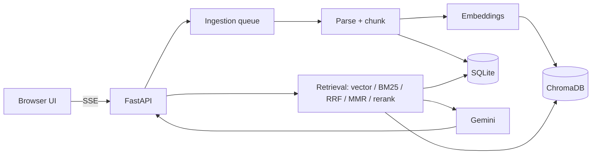

# RAG Lab Pro

Bilingual (Hindi / English / Hinglish) NotebookLM-style RAG app. Answers come only from your sources, with citations that open the exact highlighted passage.

**Features:** upload PDF/DOCX/TXT, web links (SSRF-safe), YouTube captions (timestamp links), official-source search (allowlisted domains only), background ingestion, hybrid search (vector + our own BM25 + RRF) with optional MMR / LLM rerank / query rewrite, streamed cited answers, source viewer, voice in/out, summary/FAQ/study guide, optional password login, and the **Evaluation Lab**.

**Evaluation Lab:** auto-generated EN + faithful HI question pairs with gold evidence offsets, review/approve screen, out-of-scope questions, experiments (chunk size, search mode, rerank, MMR, rewrite, top-k, language), Hit@k, Recall@k, MRR, correctness, faithfulness, citation accuracy, correct-refusal rate, latency p50/p95, tokens and estimated cost, Hindi vs English, A/B deltas, CSV/Markdown export. Results show `[X]` until real runs fill them.

## Setup (Windows / Mac / Linux)
```
python -m venv .venv
# Windows: .venv\Scripts\activate     Mac/Linux: source .venv/bin/activate
pip install -r requirements-local.txt
cp .env.example .env      # Windows: copy .env.example .env   then put GEMINI_API_KEY=... inside
python run.py
```
First chat/upload downloads the embedding model (about 470 MB, one time). Never paste your key in a chat or on GitHub.
Optional in `.env`: `APP_PASSWORD` (login for demos), `SEARCH_API_KEY` + `SEARCH_ENGINE_ID` (Google Programmable Search, for official-source search).
Verify model names in `backend/config.py` against the official Google AI docs.

## Commands
`python run.py` · `python -m pytest -q` · `python -m backend.dsa --selftest` · API docs at `/docs`

## Architecture


## Results (fill with REAL runs only)
| Config | Hit@k | MRR | Correctness | Faithfulness | HI vs EN gap |
|---|---|---|---|---|---|
| chunk 200 / hybrid | [X] | [X] | [X] | [X] | [X] |
| chunk 500 / hybrid | [X] | [X] | [X] | [X] | [X] |
| chunk 1000 / hybrid | [X] | [X] | [X] | [X] | [X] |

## Limitations
Hinglish detection uses a small word list. Judge scores (Part 2) can be wrong and samples are small. Free-tier Gemini has rate limits. The SSRF check can still be beaten by DNS rebinding between check and connection. Auto-generated gold evidence is the passage a question was written from, so other passages that also answer it count as misses. `LOW_CONF_SIM` needs tuning on your data.

## Troubleshooting
"API key missing" → fill `.env`, restart. Broken text warning → install Tesseract for OCR. Slow first run → model download.

