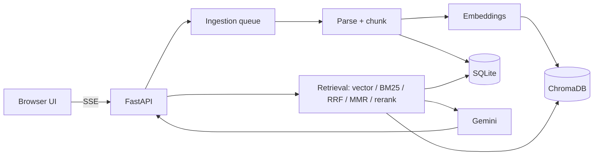

# RAG Lab Pro

Bilingual (Hindi / English / Hinglish) NotebookLM-style RAG app. Answers come only from your sources, with citations that open the exact highlighted passage.

**Features:** upload PDF/DOCX/TXT, web links (SSRF-safe), YouTube captions (timestamp links), official-source search (allowlisted domains only), background ingestion, hybrid search (vector + our own BM25 + RRF) with optional MMR / LLM rerank / query rewrite, streamed cited answers, source viewer, voice in/out, summary/FAQ/study guide, optional password login, and the **Evaluation Lab**.

**Evaluation Lab:** auto-generated EN + faithful HI question pairs with gold evidence offsets, review/approve screen, out-of-scope questions, experiments (chunk size, search mode, rerank, MMR, rewrite, top-k, language), Hit@k, Recall@k, MRR, correctness, faithfulness, citation accuracy, correct-refusal rate, latency p50/p95, tokens and estimated cost, Hindi vs English, A/B deltas, CSV/Markdown export. Results show `[X]` until real runs fill them.

## Setup (Windows / Mac / Linux)
```
python -m venv .venv
# Windows: .venv\Scripts\activate     Mac/Linux: source .venv/bin/activate
pip install -r requirements-local.txt
cp .env.example .env      # Windows: copy .env.example .env   then put GEMINI_API_KEY=... inside
python run.py
```
First chat/upload downloads the embedding model (about 470 MB, one time). Never paste your key in a chat or on GitHub.
Optional in `.env`: `APP_PASSWORD` (login for demos), `SEARCH_API_KEY` + `SEARCH_ENGINE_ID` (Google Programmable Search, for official-source search).
Verify model names in `backend/config.py` against the official Google AI docs.

## Commands
`python run.py` · `python -m pytest -q` · `python -m backend.dsa --selftest` · API docs at `/docs`

## Architecture


## Results (fill with REAL runs only)
| Config | Hit@k | MRR | Correctness | Faithfulness | HI vs EN gap |
|---|---|---|---|---|---|
| chunk 200 / hybrid | [X] | [X] | [X] | [X] | [X] |
| chunk 500 / hybrid | [X] | [X] | [X] | [X] | [X] |
| chunk 1000 / hybrid | [X] | [X] | [X] | [X] | [X] |

## Resume bullets (replace [X] with measured numbers)
- Built a bilingual (Hindi/English) RAG app with hybrid retrieval (own BM25 + vector + RRF); hybrid reached Hit@5 of [X]% vs [X]% for vector-only on [N] verified questions.
- Wrote an Evaluation Lab measuring Hit@k, MRR, faithfulness and Hindi vs English gaps; best chunk size [X] improved correctness by [X] points.
- Added citation verification and prompt-injection defences; correct-refusal rate [X]% on out-of-scope questions.
- Implemented BM25, LRU cache, heap top-k, RRF, token bucket and trie from scratch with tests.

## Interview questions (short answers)
1. *Why hybrid search?* Keywords catch exact terms, vectors catch meaning; RRF merges the ranks.
2. *Why not `\w+` for Hindi?* It splits words at combining marks (matras).
3. *How do you compare chunk sizes fairly?* Gold evidence is stored as character offsets, not chunk ids.
4. *What is faithfulness?* Every claim in the answer is supported by the retrieved text.
5. *What is SSRF and how do you block it?* Making the server fetch internal addresses; we resolve DNS and block private IPs on every redirect.
6. *Why can LLM judges be wrong?* They are models too, can favour their own style, and samples are small, so spot-check by hand.
7. *What does RRF do?* Sums 1/(60+rank) across rankings.
8. *Why a min-heap for top-k?* O(n log k) time, O(k) memory.
9. *What does MMR do?* Trades relevance against similarity to already chosen chunks.
10. *What would you improve?* A cross-encoder reranker, a larger human-verified test set, and real OCR tests.

## Limitations
Hinglish detection uses a small word list. Judge scores (Part 2) can be wrong and samples are small. Free-tier Gemini has rate limits. The SSRF check can still be beaten by DNS rebinding between check and connection. Auto-generated gold evidence is the passage a question was written from, so other passages that also answer it count as misses. `LOW_CONF_SIM` needs tuning on your data.

## Troubleshooting
"API key missing" → fill `.env`, restart. Broken text warning → install Tesseract for OCR. Slow first run → model download.

## Hosting
**Hugging Face Space (Docker):** put these files at the root of a Space, then in Settings > Secrets add `GEMINI_API_KEY` and `APP_PASSWORD`. `EMBED_BACKEND=gemini` is already set in the Dockerfile.
**Render:** create a Web Service from the repo (Docker). Add the same two secrets. `render.yaml` is included.
Hosted builds use Gemini embeddings (no local model). Free hosts have temporary disk: notebooks and uploads are lost when the app restarts or sleeps.
Always set `APP_PASSWORD` on a public URL, or strangers can use your Gemini quota.
